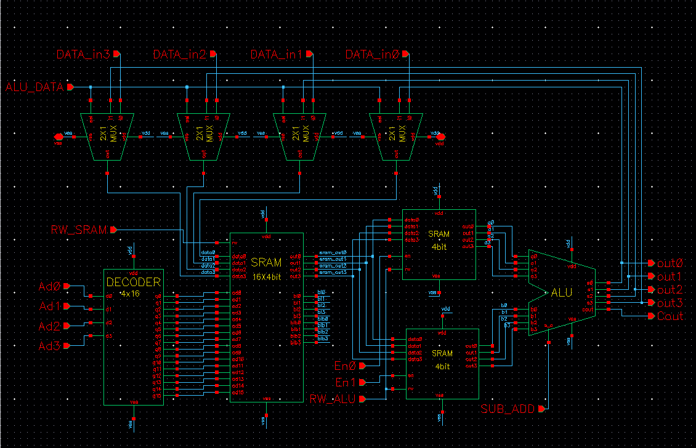
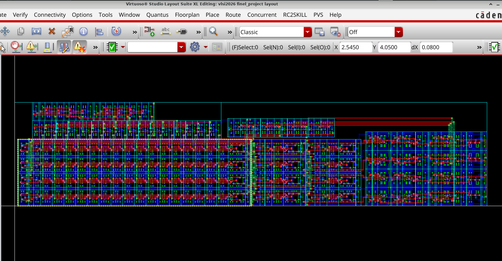

# Full-Custom VLSI Design | 4-bit ALU & 16×4 SRAM

A full-custom CMOS VLSI project designed and verified using **Cadence Virtuoso**, integrating a 16×4 SRAM array with a 4-bit arithmetic unit supporting addition and subtraction.

The project covers the design flow from transistor-level schematics and physical layout to **DRC, LVS, parasitic extraction (PEX), and post-layout verification**.

## Project Highlights

- **Memory:** 16×4 SRAM array (64 bits), based on 6T SRAM cells
- **Arithmetic:** 4-bit Ripple-Carry Adder/Subtractor
- **Addressing:** 4-to-16 Decoder
- **Data Path:** SRAM-based operand storage and ALU result write-back
- **Physical Verification:** DRC and LVS passed
- **Simulation:** Post-layout transient simulation after PEX
- **Final Layout Area:** 462.87 µm²

## Complete System Schematic

## System Architecture

The system combines a 16×4 SRAM memory with an arithmetic datapath.

Two 4-bit operands are written into the main SRAM and subsequently loaded into separate intermediate SRAM blocks. These provide both operands simultaneously to the ALU.

The ALU performs addition or subtraction using the same hardware, and the result is written back to the main SRAM through a 2:1 multiplexer.

### Main Components

- 6T SRAM cells and peripheral circuitry
- 16×4 SRAM array
- Two intermediate 4-bit SRAM blocks
- 4-to-16 address decoder
- 4-bit Ripple-Carry Adder/Subtractor
- 2:1 write-data multiplexer

## Design & Verification

The design was developed hierarchically using Cadence Virtuoso.

**Design flow:**

Schematic Design → Physical Layout → DRC → LVS → PEX → Post-Layout Simulation

The final layout passed DRC and LVS verification. Post-layout simulation was performed using extracted parasitic resistance and capacitance to verify the functionality of the integrated system.

### Final Physical Layout

The complete system was implemented using a full-custom layout in Cadence Virtuoso.

The final layout occupies approximately 462.87 µm² and successfully passed DRC and LVS verification.

### Technology & Implementation

| Parameter | Value |
|---|---|
| Supply Voltage | 1 V |
| Minimum Channel Length | 45 nm |
| Minimum Transistor Width | 120 nm |
| SRAM Capacity | 64 bits (16×4) |
| Final Layout Dimensions | 45.92 × 10.08 µm |
| Final Layout Area | 462.87 µm² |

## Functional Verification

The final post-layout simulation verifies the complete data flow: writing operands to SRAM, reading them into the ALU, performing arithmetic operations, storing the results, and reading them back for verification.

**Test case:** A = 6 (`0110`), B = 3 (`0011`)

| SRAM Address | Operation | Stored Value |
|---|---|---|
| 0 | Operand A | `0110` (6) |
| 1 | Operand B | `0011` (3) |
| 2 | Addition: 6 + 3 | `1001` (9) |
| 3 | Subtraction: 6 - 3 | `0011` (3) |

Both arithmetic results were successfully stored and read back from SRAM in the post-layout simulation.

<!-- Add the final simulation waveform here after uploading it:

-->

## Engineering Challenges & Solutions

- **SRAM Write Reliability:** Identified insufficient drive strength during write operations and added a CMOS buffer to improve write reliability.

- **Sense Amplifier Output:** Added a CMOS inverter after the sensing stage to restore logic levels and improve output drive capability.

- **Post-Layout Verification:** Verified system functionality after PEX, accounting for parasitic resistance, capacitance, and propagation delays.

## Tools & Skills

**Tools:** Cadence Virtuoso, DRC, LVS, PEX, Transient Simulation

**Technical Skills:** Full-Custom VLSI Design, CMOS, SRAM, Digital Logic, ALU Design, Physical Layout, Circuit Verification

## Design Gallery

Additional design screenshots will be organized in the `images/` directory, including:

- System schematic
- 6T SRAM cell schematic and layout
- SRAM array layout
- Decoder and ALU layouts
- Final integrated layout
- Physical verification results
- Post-layout simulation waveforms

